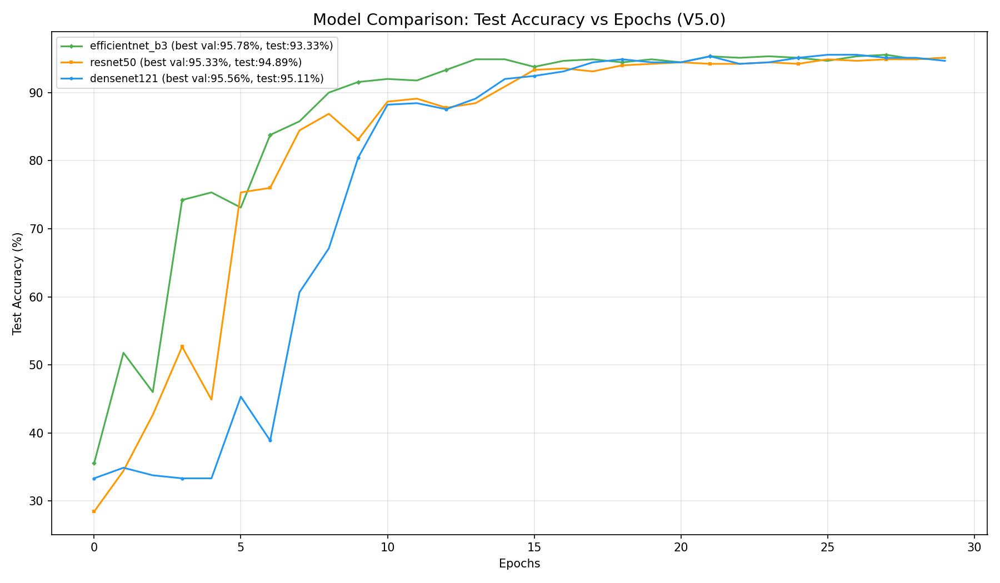

# 🐶 Animal Emotion Recognition System 🐱

基于迁移学习的宠物情绪识别系统。项目在 3000 张图片（训练集 2100、验证集 450、测试集 450）上对比 DenseNet-121、ResNet-50 和 EfficientNet-B3，完成 `Angry`、`Sad`、`happy` 三分类，并提供命令行、集成推理和 Gradio 网页界面。

本项目为大一立项的学习实践，涵盖模型训练、实验对比和推理展示。预测结果对应数据集中的图像标签，不能直接作为动物真实情绪的判断依据。详细实现与实验说明见 [技术分析报告](REPORT.md)。

## 快速开始

推荐通过统一入口 `main.py` 运行，工作目录为项目根目录。首次使用，在已创建并激活的 Python 虚拟环境中执行：

```bash
python -m pip install -r requirements.txt
python main.py
```

`python main.py` 默认启动网页界面，并自动打开浏览器访问 `http://127.0.0.1:7860`。在 IDE 中也可以直接运行 `main.py`。支持 Windows、Linux 和 macOS；使用已有权重即可预测，无需先训练。

当前界面使用 Gradio 5.x，版本范围已在 `requirements.txt` 中限定。

```bash
# 指定端口，或在服务器上关闭自动打开浏览器
python main.py web --port 7861 --no-browser

# 命令行预测；省略图片路径时使用测试集示例
python main.py predict --ensemble path/to/image.jpg

# 训练时原样传递 train.py 的参数
python main.py train --model all --epochs 30

# 查看统一入口、训练和预测的帮助
python main.py --help
python main.py train --help
python main.py predict --help
```

若通过 Git 克隆项目，请先安装 [Git LFS](https://git-lfs.com/)，再执行 `git lfs install` 和 `git lfs pull`，确认 `results/models/` 中已下载完整权重。

以下 Bash 脚本仍可使用，适用于 Linux/macOS 或 Windows 的 WSL 环境。

### 1. 创建虚拟环境并安装依赖

```bash
chmod +x scripts/*.sh
./scripts/setup_venv.sh
```

脚本创建 `.venv/` 并安装 `requirements.txt`。后续训练、推理和 Web 启动脚本会在检测到虚拟环境不存在时自动执行相同配置。

### 2. 训练

```bash
# 默认训练 ResNet-50
./scripts/train.sh

# 三模型对比训练（会生成三个模型和对比图）
./scripts/train.sh --model all --epochs 30

# 指定模型、批大小和 TTA
./scripts/train.sh --model efficientnet_b3 --epochs 30 --batch-size 16 --tta
```

`train.py` 也可以直接运行：`source .venv/bin/activate && python train.py ...`。训练数据默认从 `Master-Folder/{train,val,test}` 读取。

### 3. 命令行推理

```bash
# 使用默认模型 results/models/best_model.pth
./scripts/predict.sh path/to/image.jpg

# 不传图片时，自动用测试集里找到的第一张图片演示推理
./scripts/predict.sh

# 指定模型
./scripts/predict.sh --model results/models/best_model_efficientnet_b3.pth image.jpg

# 三模型集成（默认按验证集精度加权）
./scripts/predict.sh --ensemble image.jpg

# 三模型等权集成
./scripts/predict.sh --ensemble --equal image.jpg
```

### 4. 启动 Web 推理界面

```bash
./scripts/app.sh
# 浏览器打开 http://localhost:7860
```

界面默认使用三模型加权集成，也可以切换单个模型。若模型尚未训练，单模型和集成选项会提示缺少权重。

## 模型与训练配置

| 模型 | 参数量（约） | 主要特点 |
|:---|---:|:---|
| EfficientNet-B3 | 10.7M | 复合缩放，效率高 |
| ResNet-50 | 23.5M | 残差学习，表达能力强 |
| DenseNet-121 | 7.0M | 密集连接，特征复用充分 |

当前训练配置（见 `train.py`）包括 ImageNet 预训练权重、384×384 输入、AdamW、3 epoch warmup、CosineAnnealingLR、Dropout、Label Smoothing、EMA、RandAugment、RandomErasing 和 MixUp。训练过程中每个 epoch 输出 Train/Val/Test 指标，最佳验证集权重会被保存。

## 已有实验结果

以下单模型数据来自 `results/logs/training.log` 中 2026-07-20、seed=42、30 epochs 的三模型训练记录：

| 模型 | Best Val | 最佳 Val 轮次 | 该轮 Test（EMA） | 最终 Test（EMA） |
|:---|---:|---:|---:|---:|
| EfficientNet-B3 | 95.78% | 13 | 93.33% | 95.11% |
| ResNet-50 | 95.33% | 29 | 94.89% | 95.11% |
| DenseNet-121 | 95.56% | 25 | 95.11% | 94.67% |

`best_model_<model>.pth` 按最佳验证集准确率保存，因此 checkpoint 内的 `test_accuracy` 是最佳验证轮次对应的测试指标，并不等于最后一轮测试指标。`best_model.pth` 是 EfficientNet-B3 最佳验证 checkpoint 的便捷副本。现有权重内部的 `version` 字段为 `V5.0`，当前训练代码生成的新权重会标记为 `V5.1`，这不影响旧权重加载。

### 集成评估（既有记录）

以下数据沿用既有项目文档中的 2026-09-29 复测记录，仓库未附该次复测的独立日志。记录的评估条件为：使用 `results/models/` 中的 checkpoint，`Master-Folder/test` 共 450 张图片（每类 150 张），输入预处理与推理代码一致，集成权重来自三个模型的验证集准确率；环境为 PyTorch 2.14.0+cu130、RTX 5060。

| 方法 | 正确数/总数 | Test Acc |
|:---|---:|---:|
| ResNet-50 | 428/450 | 95.1111% |
| EfficientNet-B3 | 427/450 | 94.8889% |
| DenseNet-121 | 425/450 | 94.4444% |
| 等权软投票 | 432/450 | **96.0000%** |
| 验证集精度加权软投票 | 432/450 | **96.0000%** |

相对最佳单模型，等权和验证集加权集成均提升 `0.8889` 个百分点（多判对 4 张）。该结果只说明这组固定 checkpoint 在这一个留出的测试集上的表现，不代表所有数据或未来训练都必然提升。结果来自 2026-09-29 对仓库现有权重的完整测试集复测。

历史训练曲线：



## 结果目录

所有训练生成物都集中在 `results/`，代码会自动创建缺失目录：

```text
results/
├── models/
│   ├── best_model.pth
│   ├── best_model_densenet121.pth
│   ├── best_model_efficientnet_b3.pth
│   └── best_model_resnet50.pth
├── logs/
│   └── training.log
└── plots/
    ├── confusion_densenet121.png
    ├── confusion_efficientnet_b3.png
    ├── confusion_resnet50.png
    └── model_comparison_test_acc.png
```

因此，训练不会再向项目根目录写入模型、日志或图片。推理代码和 Web 界面也只从 `results/models/` 查找权重。单模型训练还会生成 `results/plots/test_acc_<model>.png`。

## 项目结构

```text
.
├── Master-Folder/          # ImageFolder 数据集（train/val/test）
├── scripts/
│   ├── setup_venv.sh       # 创建 venv 并安装依赖
│   ├── train.sh            # 启动训练
│   ├── predict.sh          # 启动命令行推理
│   └── app.sh              # 启动 Gradio Web 推理
├── main.py                 # 统一入口（默认启动网页，可选训练/预测）
├── train.py                # 训练与评估
├── predict.py              # 单模型/集成推理 API 与 CLI
├── app.py                  # Gradio 界面
├── requirements.txt
├── REPORT.md               # 技术分析报告
└── results/                # 模型、日志和图表
```

## Python API

```python
import predict

model, device, size, classes = predict.load_model(
    "results/models/best_model_efficientnet_b3.pth"
)
result = predict.predict_image("image.jpg", model, device, size, classes)
print(result)

models, weights = predict.load_ensemble_with_weights(
    {"resnet50": 95.33, "efficientnet_b3": 95.78, "densenet121": 95.56}
)
result = predict.predict_ensemble("image.jpg", models, weights)
```

## 注意事项

- 首次运行需要联网下载 Python 依赖和 torchvision 的 ImageNet 预训练权重。
- GPU 会自动使用 CUDA；没有 GPU 时会回退到 CPU，训练时间会明显增加。
- 图片类别目录名会成为类别标签，请保持 `Master-Folder` 的目录结构不变。
- 当前实现每个 epoch 都会计算测试集指标；正式对比实验中不应根据这些中间测试结果调整超参数，以免造成测试集信息泄漏。
- `requirements.txt` 尚未锁定依赖版本，不同环境下的兼容性和实验数值可能存在差异。

## 提交到 GitHub

`.gitignore` 仅忽略虚拟环境、缓存和本地配置，保留数据集、训练日志及结果图。四个模型权重合计约 200 MiB，已在 `.gitattributes` 中配置为使用 Git LFS 管理，文件内容无需修改。

首次提交前，在项目根目录执行（需先安装 Git 和 Git LFS）：

```bash
git init
git lfs install
git add .
git lfs ls-files
git status
git commit -m "Initial commit"
git branch -M main
```

确认 `git lfs ls-files` 列出四个 `.pth` 权重后，按 GitHub 空仓库页面的提示添加远程地址并推送。克隆时需使用 Git LFS 下载权重；GitHub 的 ZIP 下载可能只包含权重指针文件。

## 数据来源与致谢

数据集来源：[dhuyng/CV---Animal-Emotion-Recognition](https://github.com/dhuyng/CV---Animal-Emotion-Recognition)。感谢该项目提供的公开资料。

上游仓库未见明确的数据集授权说明，公开发布图片前仍需确认再分发许可。项目目前未声明开源许可证。
